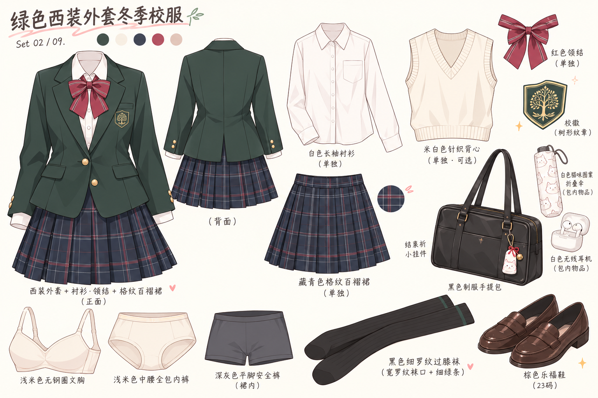

# Mittes 秋季服饰设定图

共 9 套，纯服饰平铺，无人物。参考 doc/Mittes人设图/anima1_00145_.png 的二次元线条与色块，用 imagegen 内置工具生成。

每张包括主要服装、鞋袜、配饰和内衣；睡衣不配鞋袜。配置原文保存在 wardrobe-source.toml，完整提示词及睡衣修正提示词保存在 prompts.json。

## 01 · 黑白女仆装

新版按用户提供的款式重设计，外装与内搭分开绘制。[查看两张图与说明](../maid-split-v2/README.md)。

## 02 · 绿色西装外套冬季校服

## 03 · 奶白色水手领卫衣配浅灰短裤

## 04 · 有口袋的燕麦色针织背心裙

## 05 · 米白短风衣配酒红格纹百褶裙

## 06 · 浅樱粉短开衫配藏青细格百褶裙

## 07 · 白色短款外套配浅樱粉滑冰练习裙

## 08 · 赶场用的燕麦色宽大开衫配黑百褶短裙

## 09 · 浅蓝细棉长袖睡衣

