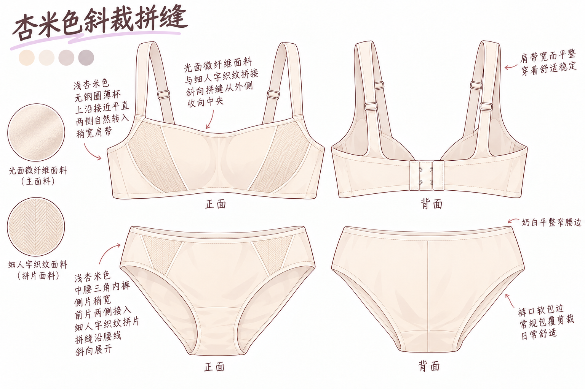
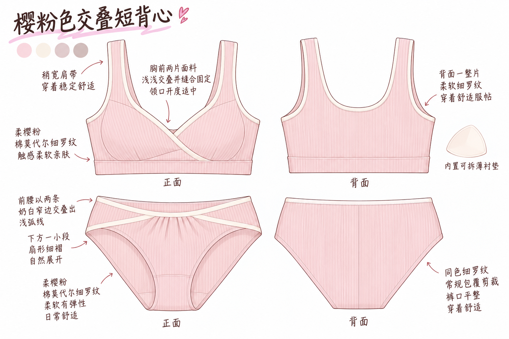
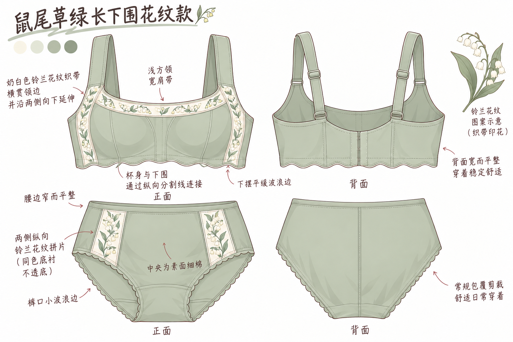
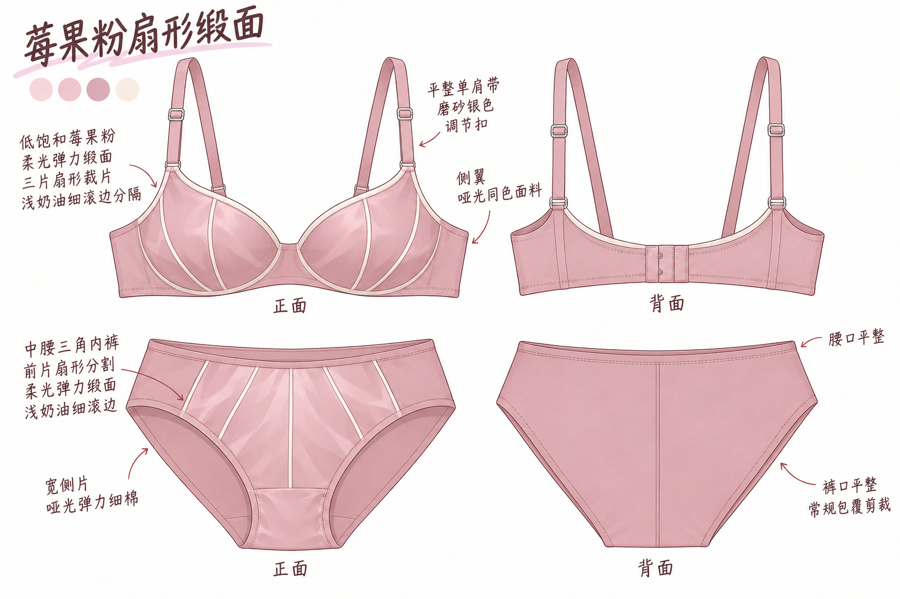
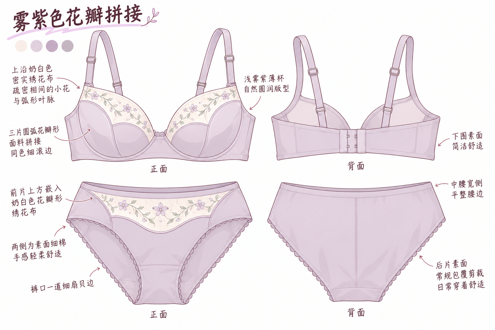
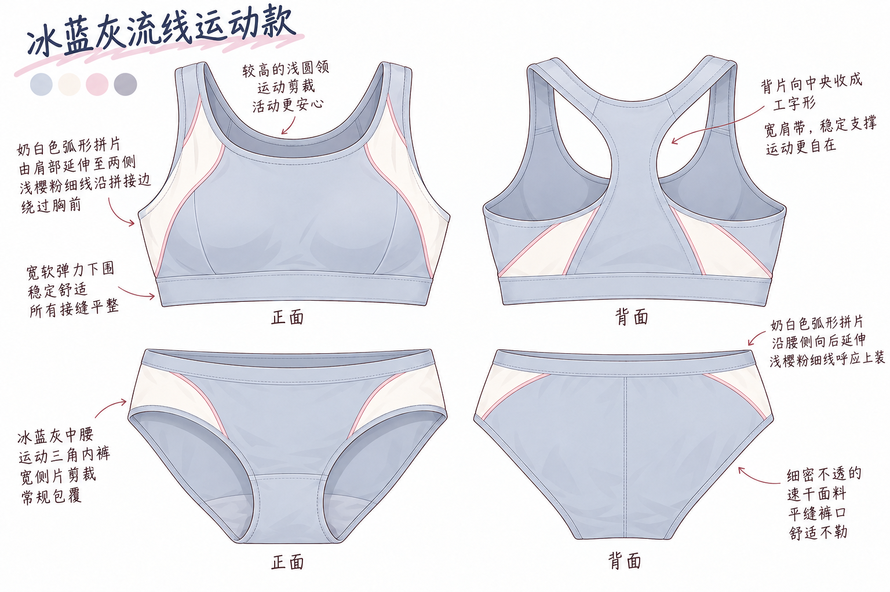
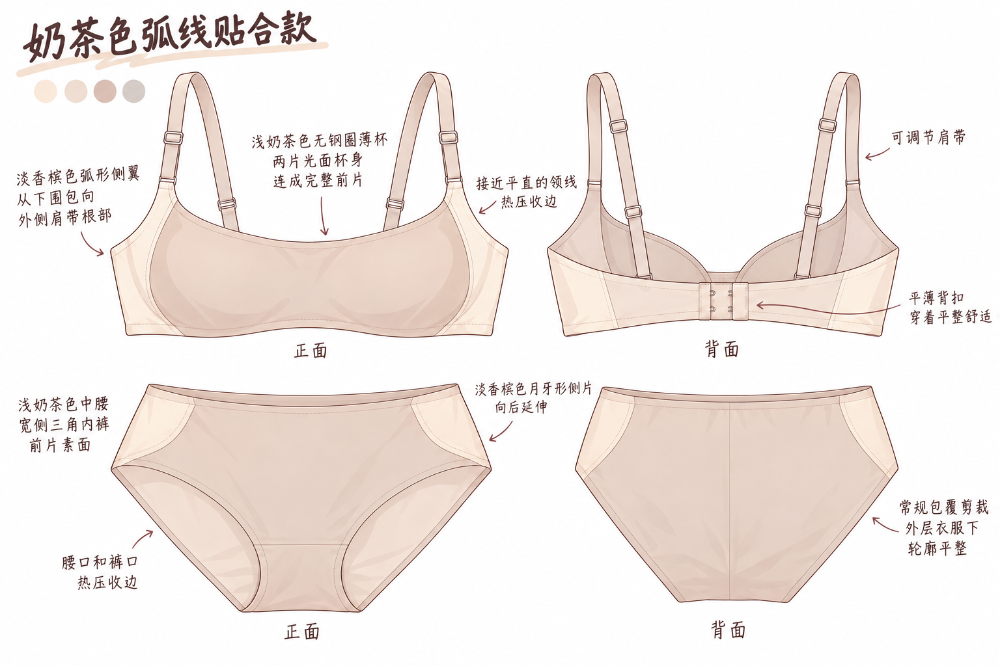
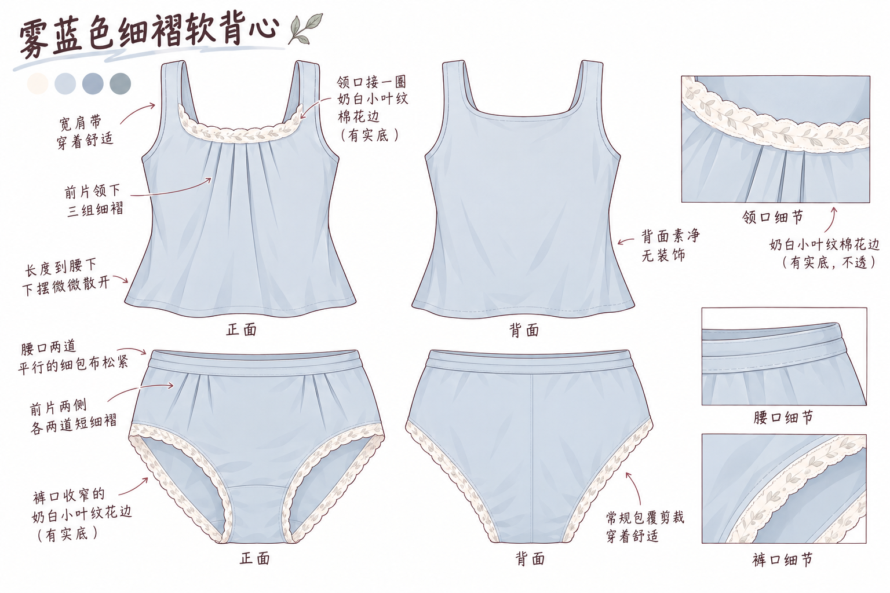

# Mittes · 八款独立内搭设定图

由内置 imagegen 生成，统一使用已认可的[女仆装内搭图](../maid-split-v2/02_黑白女仆装_内搭.png)作为画风参考：柔和细线、轻色块、少量阴影、手写标注。每套一张，包含上装与内裤的正反面；无人物、无安全裤。

八套按不同的版型、裁片与面料组合设计，完整文字见 [designs.md](designs.md)，完整提示词、参考图路径和生成源文件见 [prompts.json](prompts.json)。生成时的衣柜快照见 wardrobe-source.toml。

校服外装已换成[秋季水手校服](../autumn-school-v1/README.md)。其他外装仍沿用原图；旧合图中的内搭以本图集为准。

## 02 · 白色长袖水手服配藏青百褶裙

**杏米色斜裁拼缝** — 平直领线、斜向拼缝、低对比织纹，借用衬衫的利落感。

## 03 · 奶白色水手领卫衣配浅灰短裤

**樱粉色交叠短背心** — 交叠裁片与宽下围形成轮廓，不再用花朵区分家居款。

## 04 · 有口袋的燕麦色针织背心裙

**鼠尾草绿长下围花纹款** — 加长下围、纵向裁片与成片纹样，轮廓偏复古。

## 05 · 米白短风衣配酒红格纹百褶裙

**莓果粉扇形缎面** — 用缎面光泽和扇形裁片做主设计，配色更鲜明。

## 06 · 浅樱粉短开衫配藏青细格百褶裙

**雾紫色花瓣拼接** — 花瓣形裁片决定轮廓，刺绣成为拼片的一部分。

## 07 · 白色短款外套配浅樱粉滑冰练习裙

**冰蓝灰流线运动款** — 高圆领、运动背片与冰刀轨迹般的流线拼接。

## 08 · 赶场用的燕麦色宽大开衫配黑百褶短裙

**奶茶色弧线贴合款** — 平直领线、包覆式侧翼与无痕边，靠结构体现精致。

## 09 · 浅蓝细棉长袖睡衣

**雾蓝色细褶软背心** — 方圆领、细褶与柔软花边，保留睡眠用的宽松感。

