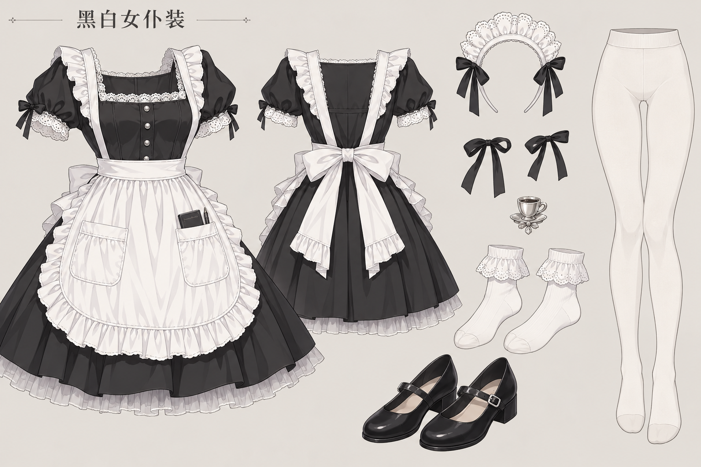
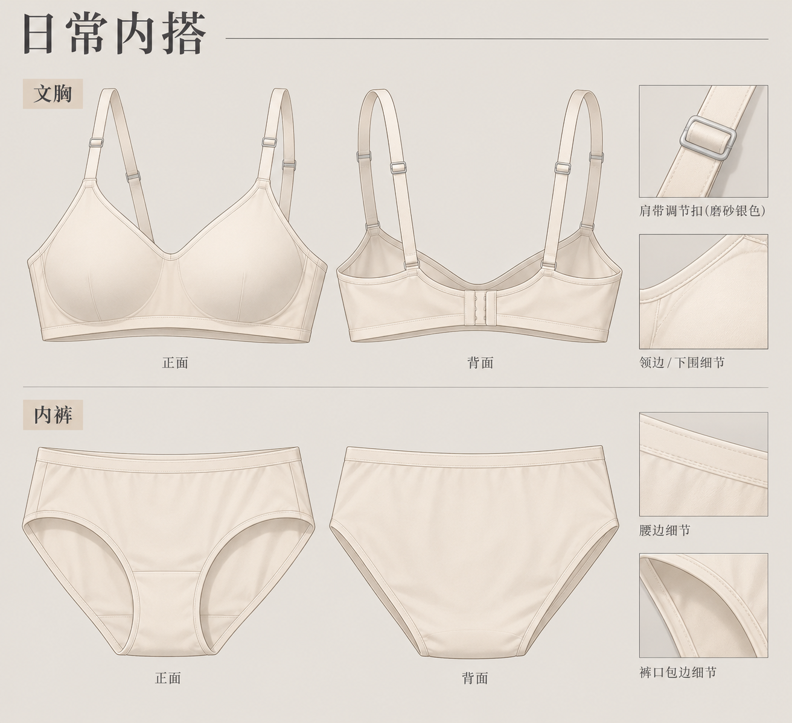

# 黑白女仆装 · 外装与内搭分图

根据 wardrobe.toml 的文字使用内置 imagegen 重新生成，不使用参考图。纯服饰设定图，无人物、无安全裤。

外装与内搭分为两张，内搭采用暖米白光面日常款，窄包边、磨砂银色肩带调节扣，不加蝴蝶结。生成时的衣柜原文保存在 wardrobe-source.toml，完整提示词见 prompts.json。

## 黑白女仆装

## 日常内搭

