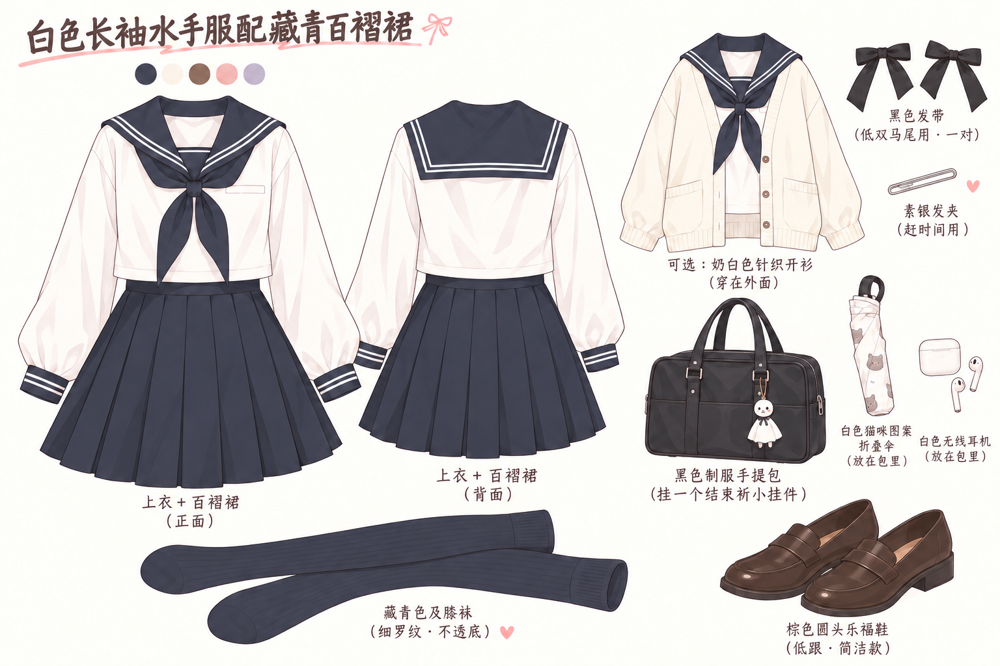
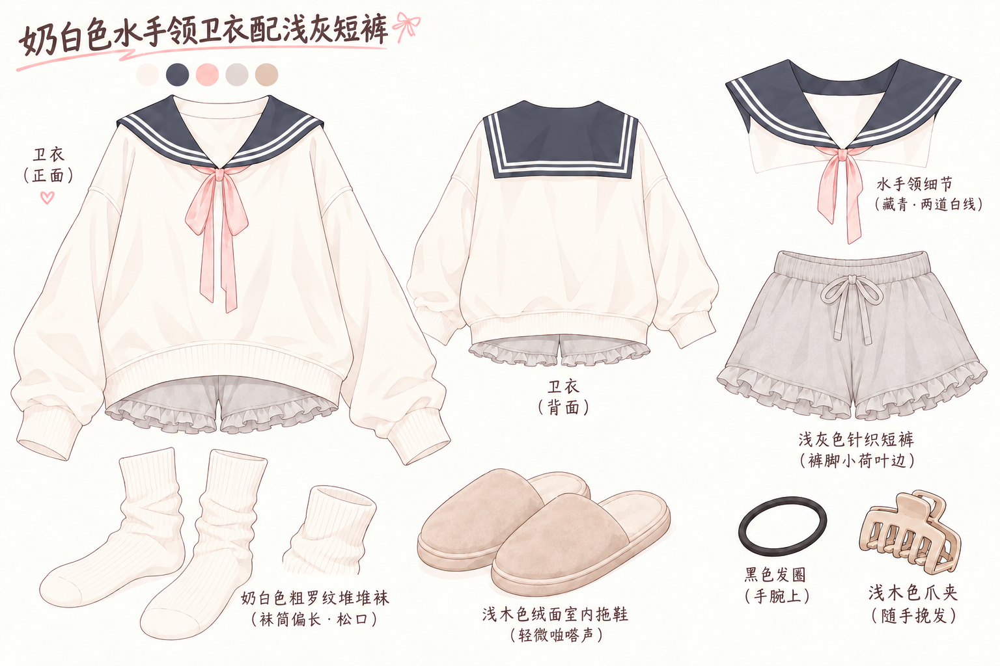
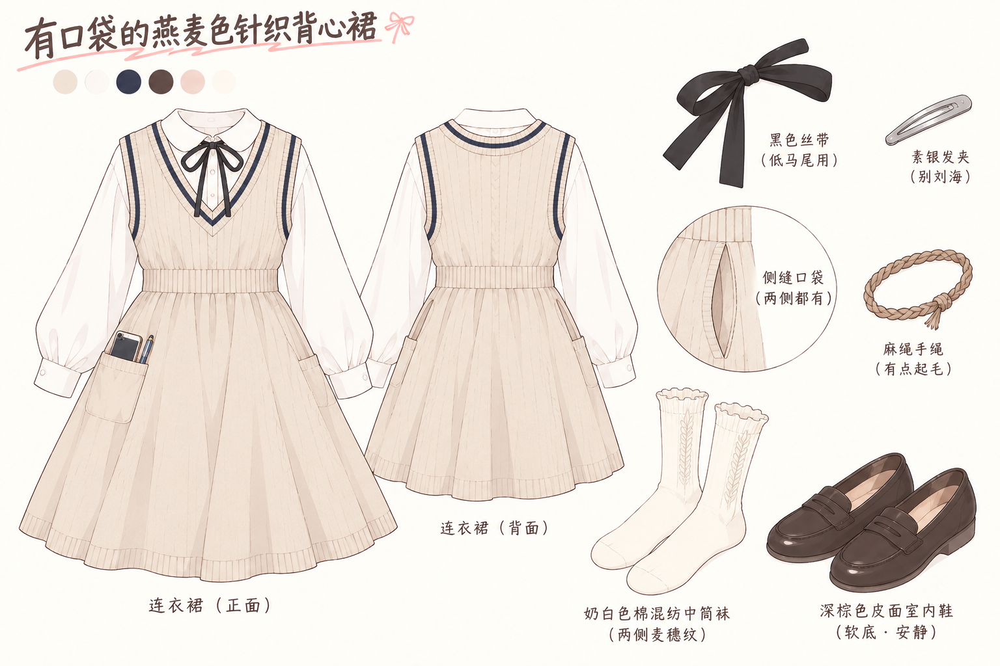
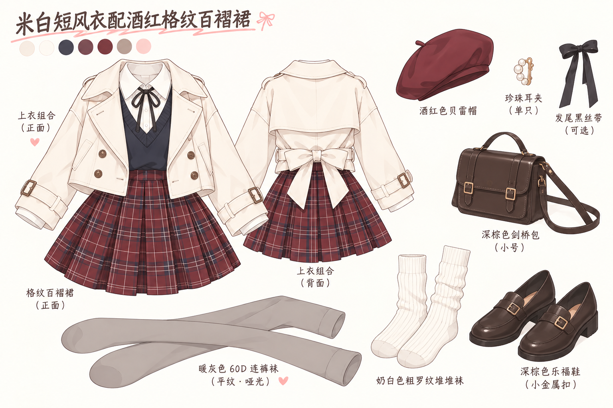
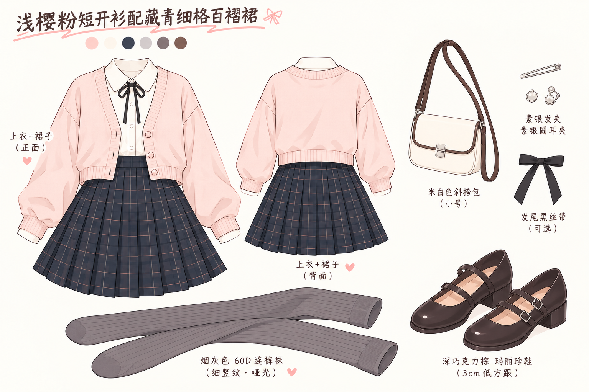
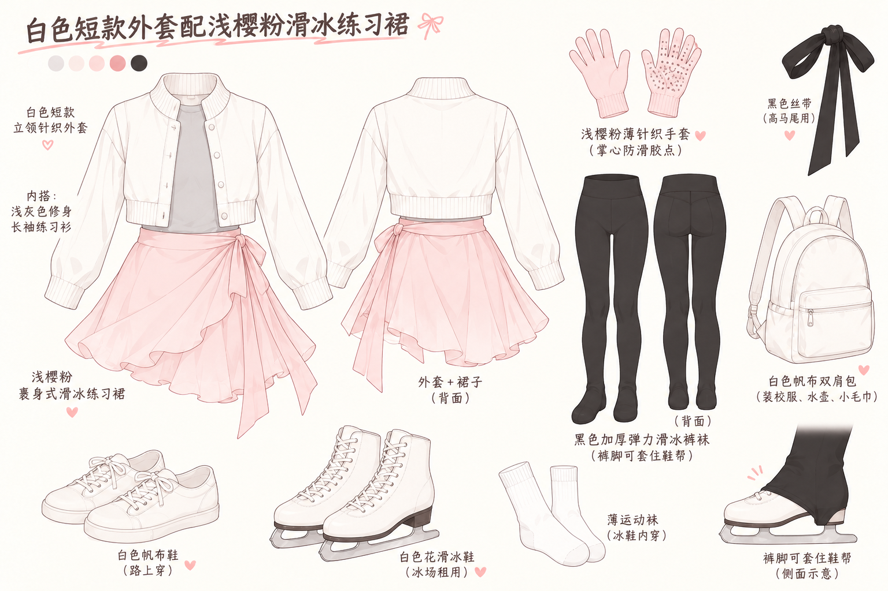
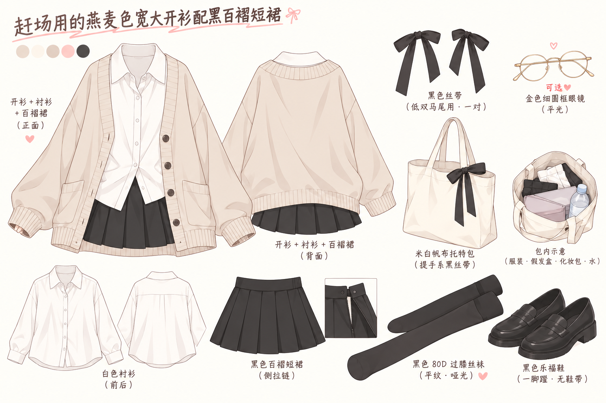
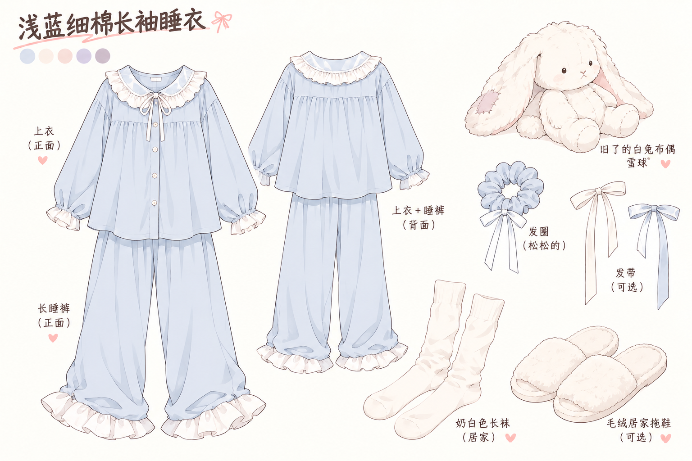

# 外搭设定图 · v6

其余八套外搭按黑白女仆装的固定画风重新生成。女仆装本身保留为基准；所有图仅画衣物与对应配件，内搭独立展示。

- [固定画风规范](../../../art-direction/STYLE.md)
- [完整提示词与生成记录](prompts.json)
- [生成时衣柜文字](wardrobe-source.toml)

使用内置 imagegen，每套独立生成，直接传入固定外搭参考图。前两张另外进行了仅删除错误编号的编辑，完整编辑提示词一并留存。

## 白色长袖水手服配藏青百褶裙

## 奶白色水手领卫衣配浅灰短裤

## 有口袋的燕麦色针织背心裙

## 米白短风衣配酒红格纹百褶裙

## 浅樱粉短开衫配藏青细格百褶裙

## 白色短款外套配浅樱粉滑冰练习裙

## 赶场用的燕麦色宽大开衫配黑百褶短裙

## 浅蓝细棉长袖睡衣

