# 冬季衣柜设定图 · winter-v1

2026-11-14 定稿的第 7 轮审稿结果（用户在审稿页逐套认可）。外搭按固定画风 v1 生成；部分款式附用户提供的款式参考图（只取服装款式）。内搭沿用秋季同一用途的设计与设定图。

尚未启用：现役衣柜仍是 `wardrobe.toml`（秋季）。启用时把 `wardrobe-winter.toml` 与两份 `-winter` 映射换为正式文件，并同步 `schedule/skeleton.toml` 的 outfit。

- [完整提示词与来源](prompts.json)
- [生成时衣柜文字](wardrobe-source.toml)

## 黑色长袖长裙女仆装配白色长围裙

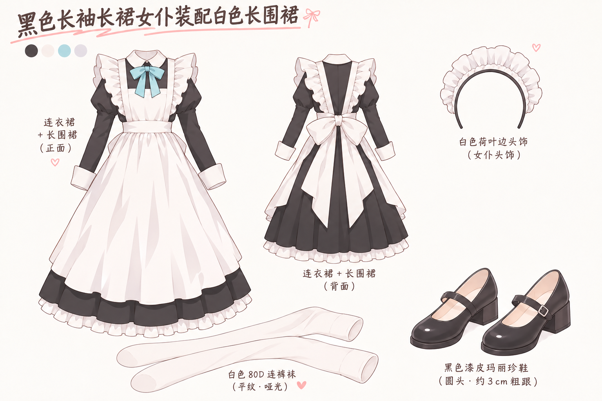

## 素色酒红和服配藏青袴与白围裙

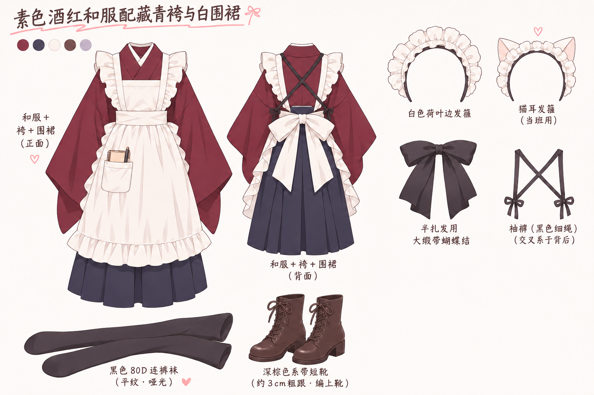

## 黑色西装外套配酒红领结和灰格纹百褶裙

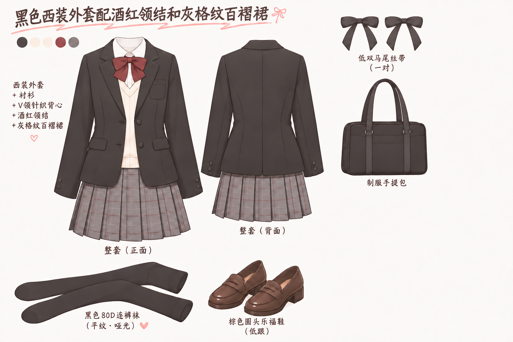

## 红色运动外套配白色体操衫和运动长裤

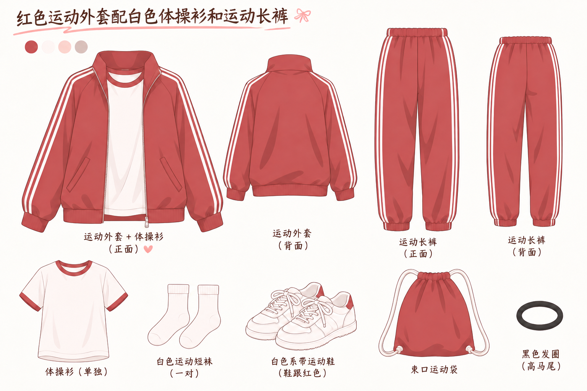

## 酒红棒球外套配白色连帽卫衣和黑色百褶短裙

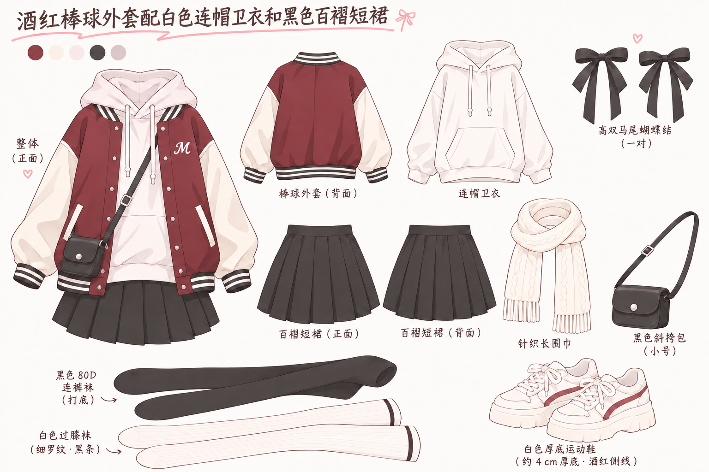

## 驼色短大衣配奶白麻花毛衣和酒红百褶裙

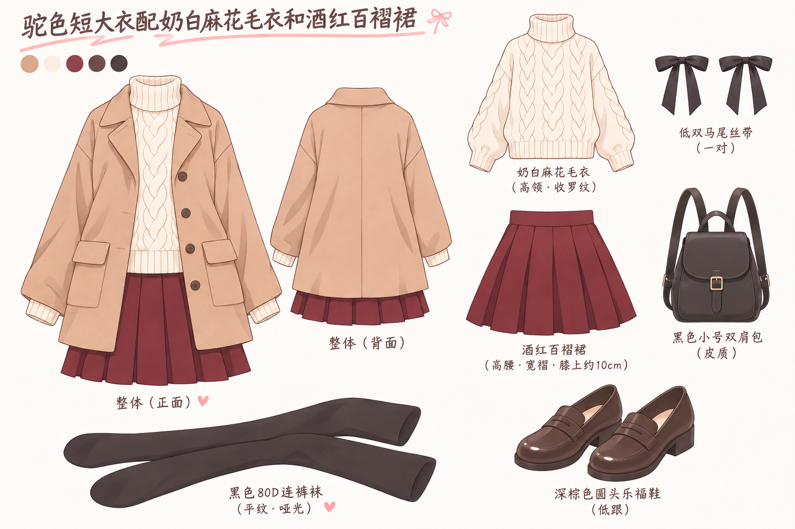

## 奶白粗棒针开衫配深蓝牛仔长裙

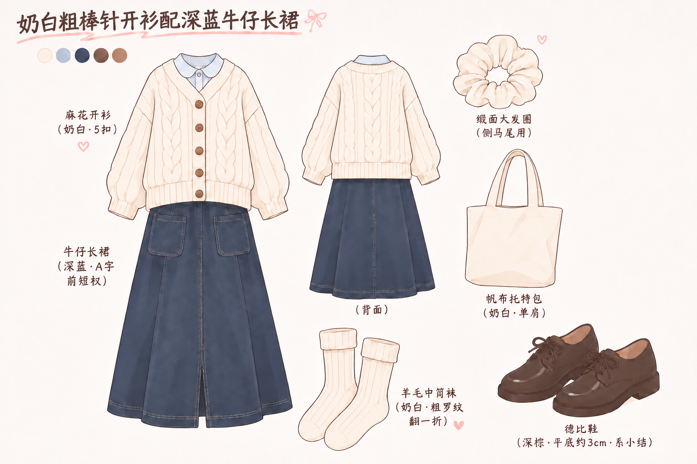

## 燕麦色高领毛衣配有口袋的藏青灯芯绒背带裙

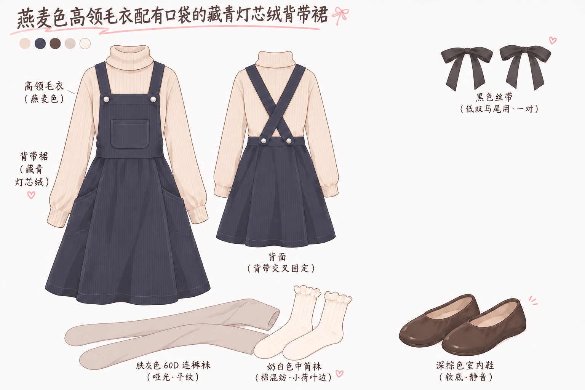

## 浅雾蓝荷叶领长袖睡裙

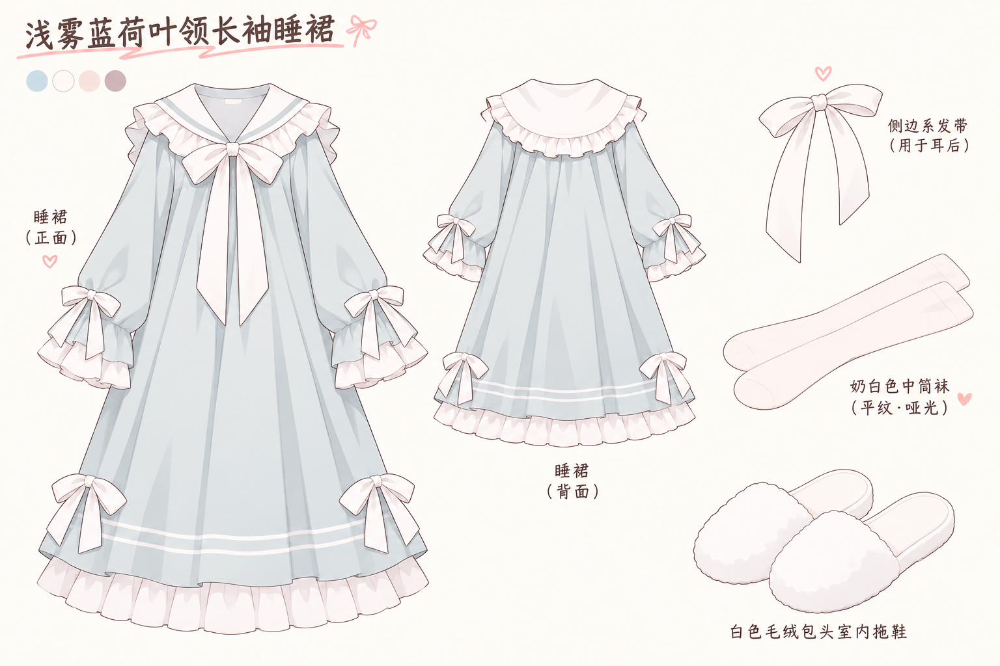

## 正红古典花纹振袖配金色袋带和白色毛绒披肩

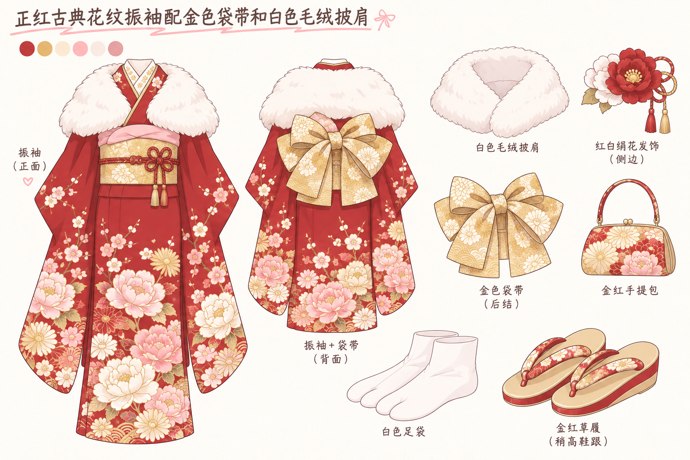

## 白色蕾丝领和服配红色腰带

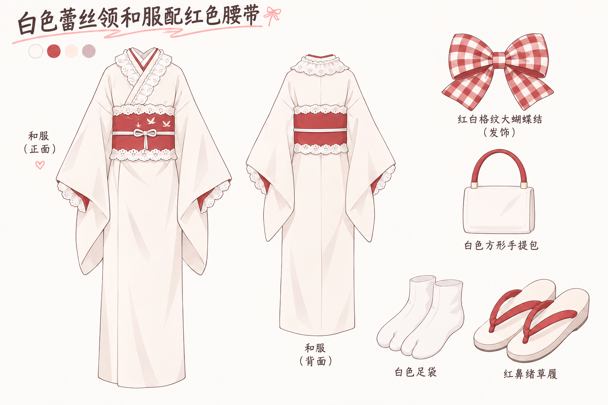
