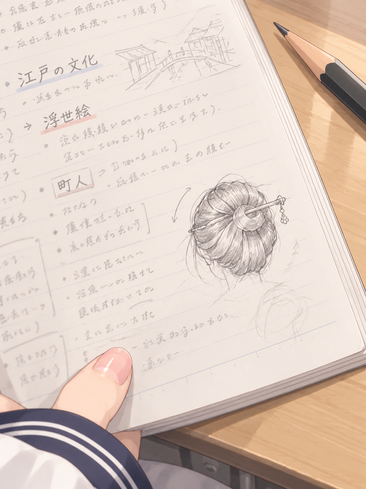
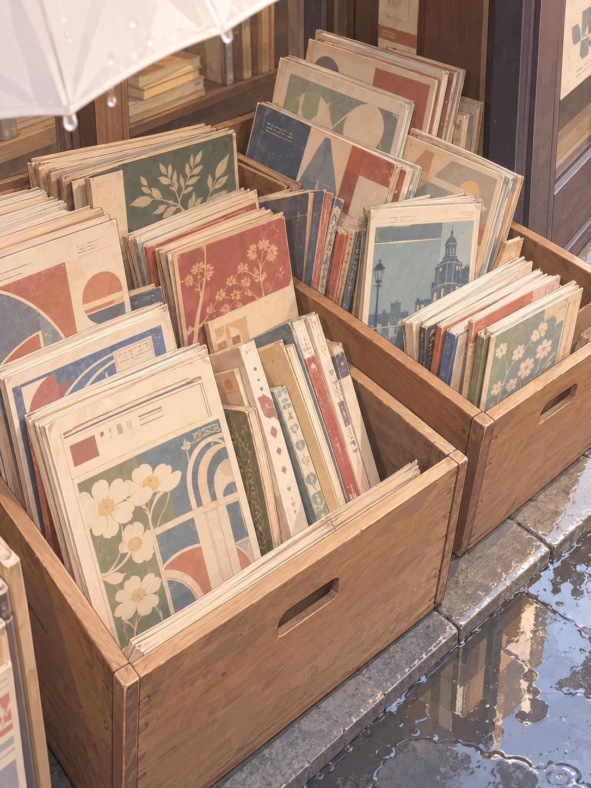
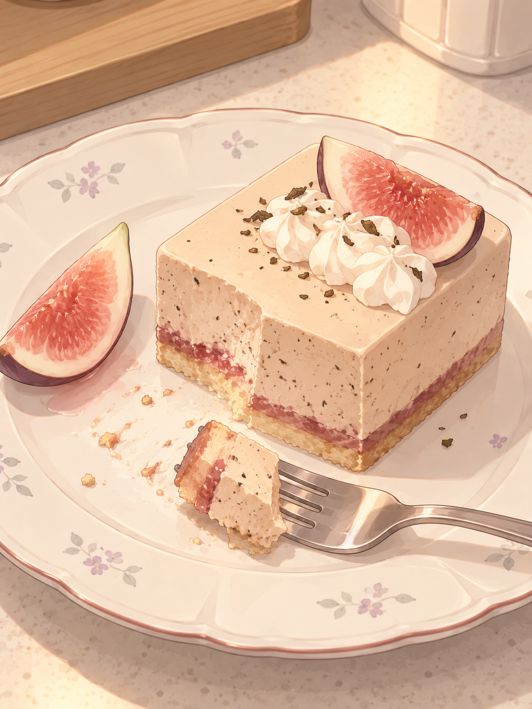

# 2026-10-14：生活场景分享测试 v6

生成日期：2026-10-16。依据前天（10 月 14 日）日程重走一次选材。按本轮要求，只做身边生活场景的随拍，不选游戏或屏幕截图。旧样例保留供历史对照。

三个具体分钟是时段内推定的演练时点，不是原日程精确记录，也不是三次自动发送计划。接收者默认是没有一起经历这些事情的熟悉聊天对象；不是默认发给就在身边的 Sweyn 或 Niya。

## 全天判断

| 时段 | 判断 |
|---|---|
| 02:00–07:30 睡眠 | 没有开口理由，排除。 |
| 07:30–08:45 起晚赶路 | 有急促感但没有停手拍照的合适窗口，不为了出图安排自拍。 |
| 08:45–12:20 历史课 | 草图提供了可分享的具体对象；上课时不发，留到午休短暂空档。 |
| 12:20–13:10 午休、帮摄影部造型 | 午休前半段测试笔记草图。后半段实际帮忙时不另造拍照；不将模特面部或摄影部屏幕当分享素材。 |
| 13:10–15:00 神保町雨中散步 | 选雨棚下看木箱旧刊的瞬间，照片指向眼前令她停步的东西。 |
| 15:00–16:00 回程挑片 | 原文满意的是含脸肖像，当前不选；不强行改成相机屏幕照片。 |
| 16:00–19:00 接待客人 | 工作进行中，内容常规，不发工作汇报。 |
| 19:00–21:00 晚市解围 | 客人打翻杯子属于需要处理的事情，不因它进了 topic 就拍下来分享。 |
| 21:00–22:00 蛋糕胚放凉 | 香气与收尾氛围可作备选；这轮已有更明确的慕斯成功片段，不再选第二条甜点。 |
| 22:00–23:00 梳洗护理 | 舒服下来不等于有主动分享动机，本轮略过。 |
| 23:00–24:00 慕斯试吃 | 得到肯定后有明确的小雀跃，选试吃后的盘子与切口。 |
| 24:00–26:00 修照片 | 专注工作且主体涉及肖像和软件屏幕，当前不选。 |

## 三个图文样例

### 12:25 · 笔记边上的发髻

> 这个发髻，好想试着盘一次。

取自上午历史课的笔记草图，放到午休短暂空档分享；想盘一次是依据兴趣作出的表达推断。

[完整提示词](sketch-prompt.txt)

### 14:10 · 雨棚下的旧书箱

> 这几箱书，好想一本本翻过去。

取自神保町雨棚下看旧刊的片段；拍吸引她停步的木箱，而非整条街的景观。

[完整提示词](books-prompt.txt)

### 23:20 · 红茶无花果慕斯

> 这次不改了，就这个味道。

取自让 Sweyn 试吃并得到肯定后的满足；用切过的小样承接文字，不复述制作和试吃全过程。

[完整提示词](mousse-prompt.txt)

## 事实与表达的分界

原文确定的事实包括：课堂画了发髻草图、雨棚下看木箱中的过期刊物、慕斯试吃得到肯定。想亲自盘一次、想一本本翻、决定保留配方，是这轮依据原有情绪拟出的主动表达，并未写回原日程。

笔记文字、草图形状、书刊封面、食物摆放和器皿是视觉补全。校服袖口已对照当前衣柜：白色长袖、藏青袖口两道细白线。三图均经目视检查，无可见人脸，没有屏幕和游戏截图。

使用内置 imagegen，每个场景一张，未做二次修订。

[日程原文快照](schedule-source.json) · [生成来源与检查记录](generation.json)
