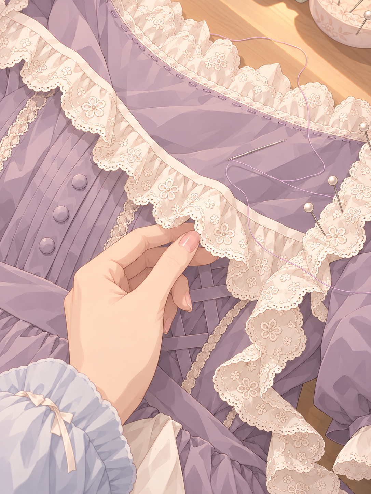
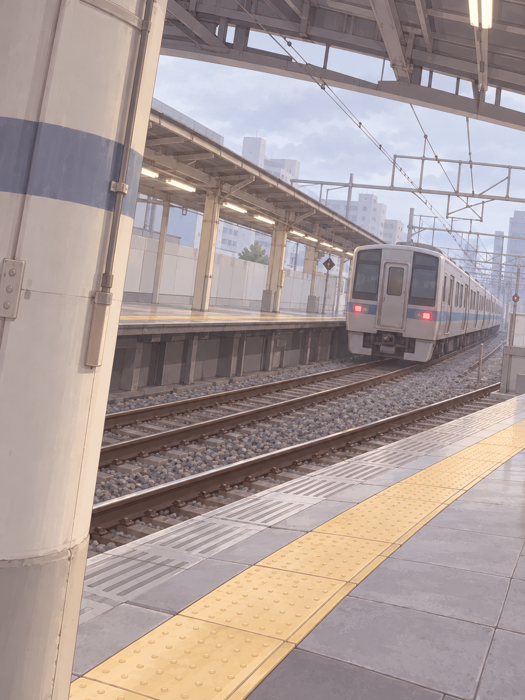
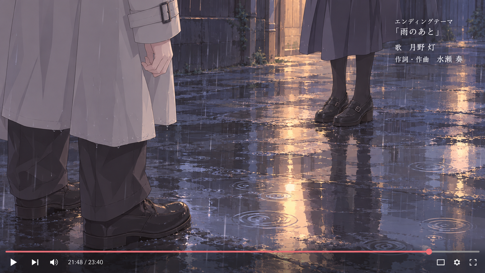

# 主动联系：三场景重绘 v4

本轮根据反馈，围绕“她会分享什么”分别使用局部随拍、离站列车随拍和番剧截图。三个场景均重新生成；人物局部自然入镜，画面中无可见人脸。取景是本轮创作选择，不将用户举例固化为永久模板。

使用内置 imagegen，固定外搭基准控制画风，首版缝衣服图辅助保持同系列观感。

## 缝Cos服_随拍

> 蕾丝还没缝完，已经想穿了……

手拎蕾丝的紧凑局部取景。

[完整提示词](sewing-prompt.txt)

## 错过电车_随拍

> 那班车一定是看见我了才关门的。

将刚离站的列车作为分享目标，采用偏斜、遮挡式随拍构图。

[完整提示词](station-prompt.txt)

## 番剧ED_截图

> 片尾曲能不能晚十秒再进来啊……偏偏停在这里。

直接截取虚构番剧 ED，人物取景在腰部以下，保留片尾字幕与播放进度。

[完整提示词](ed-prompt.txt)

ED 是虚构番剧截图样例，人物、曲名、署名与播放时间均为本次补全。

[生成来源与检查记录](generation.json)
