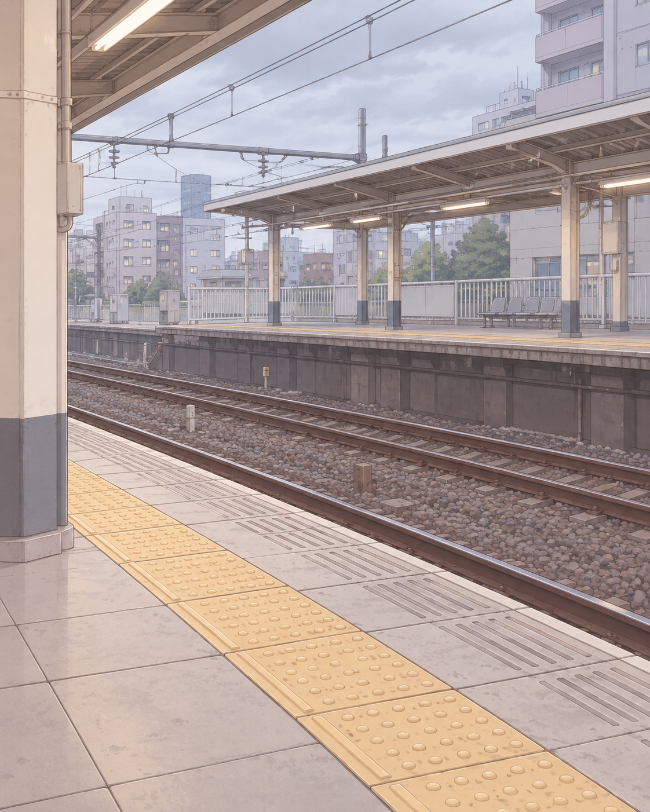
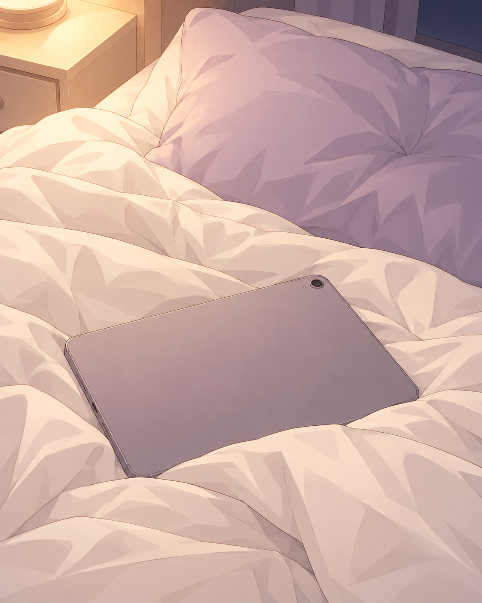

# 主动联系图文样例：画风一致性补充

使用内置 imagegen 生成。两张共同使用固定外搭画风基准，以及第一张缝衣服图作为场景表现辅助参考。完整提示词与来源随图保存。

依据上一轮 2026-10-15 日程，生成日期为 2026-10-16。

## 错过电车

> 那班车一定是看见我了才关门的。

站台布局与建筑是场景补全，不指认真实车站。

[完整提示词](station-prompt.txt)

## 追番断在关键处

> 片尾曲能不能晚十秒再进来啊……偏偏停在这里。

卧室配色与家具是场景补全；平板扣在被子上来自原日程。

[完整提示词](anime-prompt.txt)

## 同系列首图

> 蕾丝还没缝完，已经想穿了……

[生成记录](generation.json)
