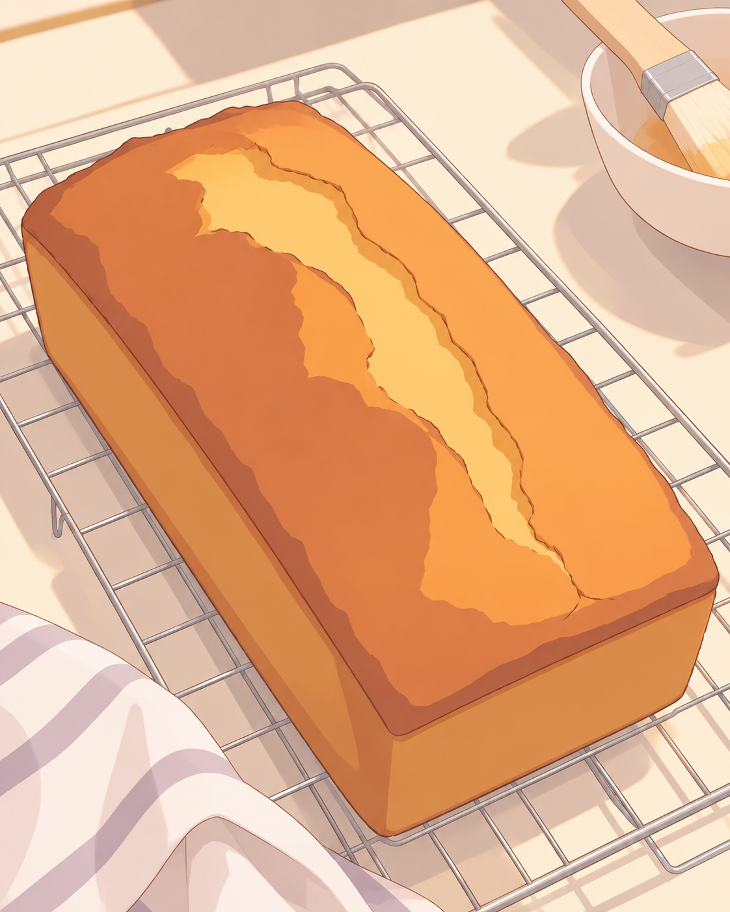
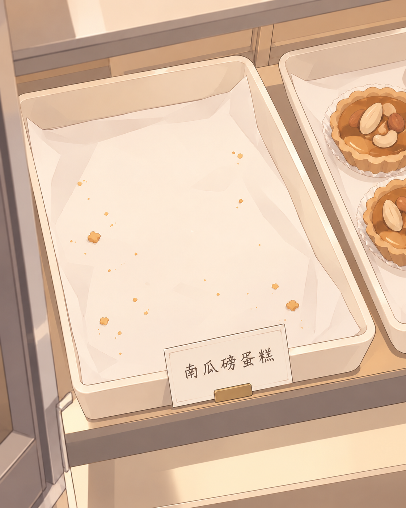

# 2026-10-17 日程主动分享测试 · v8

本轮恢复原先认可的画风：暖棕细线、轻盈配色、柔和赛璐璐阴影。复杂物件减少微观纹理、细碎色块和背景信息，保持可识别的形状。没有采用碧蓝档案试验版作为新基准。

这是根据明日日程预演的候选，不代表事件已发生，也不是三条都必须发送。具体分钟是测试取样点，实际触发应以事件进度与空闲状态为准。

## 三个候选

| 测试时点 | 什么触动了她，为什么想说 | 此刻是否适合联系 | 开场与媒介 |
|---|---|---|---|
| 12:50 左右 | 刚出炉的蛋糕香气很强，想把眼前这个东西给人看一眼 | 糕点放稳、刷完糖浆之后，可以短暂拿手机 | 图＋“这个香味有点过分了。” |
| 14:25 左右 | 两道绕人的立体几何题终于处理完，想松口气 | 收好作业、换装之前，有一个自然空隙 | 纯文字：“终于写完了，今天先别让我看见几何题。” |
| 21:20 左右 | 打烊清点时发现南瓜蛋糕全卖完了，有一点意外和满足 | 已结束营业、正在柜前，适合随手拍下空位 | 图＋“南瓜的居然一块都没剩。” |

第一条不交代称料、搅拌、烘烤流程；第三条不把销量、员工餐、收工感受一起说完。话题的背景留给对方想问的时候。

三条之中，我最倾向保留晚上那条：有具体结果，空托盘本身就承载了分享理由。中午那条是较轻的感官分享；若已经发过，晚上自然有后续感，但不应为了凑连载强制发送。作业这条作为纯文字候选，触动较弱，可以跳过。

### 12:50 · 刚出炉

> 这个香味有点过分了。

只拍工作台的一小块，整条蛋糕、晾架、边缘的刷子。没有为了展示内部组织额外发明切片或试吃情节。器皿、光照和具体摆放是视觉示例补全，不是日程已有事实。

初稿仍出现了密集的蛋糕表皮纹理，因此做了一次局部画风修正。最终用大色块和少量轮廓表现烘烤裂口；这一版也用于测试“简化多少比较合适”，并不自动成为新风格基准。

### 14:25 · 作业终于结束

> 终于写完了，今天先别让我看见几何题。

用文字就能传达刚脱离繁琐题目的轻松，不为配图另造题目、分数或考试结果。

### 21:20 · 空掉的托盘

> 南瓜的居然一块都没剩。

注意力落在空掉的格子。旁边仅留两块坚果挞，与日程一致；图中的小价签只标识品名，没有补造价格。牌子与托盘外观属于视觉补全。初稿底部自动添加了其他糕点，编辑时已移除。

## 完整日程筛选

| 日程 | 本轮判断 |
|---|---|
| 02:00–09:00 睡眠 | 不联系。 |
| 09:00–11:00 赖床刷手机 | 日程只有闲适状态和普通浏览，没有值得单独分享的具体发现，不硬造新闻或截图。 |
| 11:00–13:00 吃饭、烤甜点 | 选出炉后的短暂分享。 |
| 13:00–14:30 写作业 | 选完成后的纯文字候选，强度较低。 |
| 14:30–15:30 换装、扎牢头发 | 为工作准备，没有明显新触动，不强行配局部自拍。 |
| 15:30–18:30 忙碌、遇到挑剔客人 | 当时忙，且故事已经写明烦躁被常客的道谢冲淡，不刻意延长情绪到晚上。 |
| 18:30–21:00 晚市 | 几乎没有空隙，不联系。 |
| 21:00–22:30 清点、员工餐 | 选清点发现售罄的瞬间，不把整段收工生活复述出来。 |
| 22:30–24:00 洗澡、写手账 | 平静整理，没有新增强触动；不为了图文展示手账而杜撰内容。 |
| 24:00–26:00 与 Niya 聊天 | 实际已是 10 月 18 日凌晨。正在与好友聊天，本轮不再转发另一个人的聊天内容或制作屏幕图。 |

## 日程依据与边界

来源：插件数据库 `mittes-dev/data/plugins/khiqwq.a-day-with-mittes/schedule.db` 中日期为 `2026-10-17` 的 segments。本轮读取快照见 [schedule-source.json](schedule-source.json)。

原始晚间故事写了“下午烤的”，但实际烘烤时段在 11:30–13:00；本轮按具体时段处理，没有向分享开场带入这个不一致。晚间 topic 比 story 更强调“备受鼓舞、疲惫消散”，本轮只采用售罄这一事实和轻微满足，没有放大成强烈情绪。

图像仅限生活场景；无脸、无游戏及屏幕截图。没有修改日程、插件、衣柜映射或固定画风文件，也没有发送或安排消息。

## 生成记录

使用内置 imagegen，原始固定外搭图控制线条与上色，最早的缝衣生活片段辅助控制局部构图；参考图中的服饰、蕾丝和道具不作为本轮内容。

- [完整初始提示词与参考路径](prompts.json)
- [两次针对性编辑提示词](edit-prompts.json)
- [图片生成来源与目视检查记录](generation.json)
- 最终 PNG 就在本目录；生成工具的原始文件保留。
