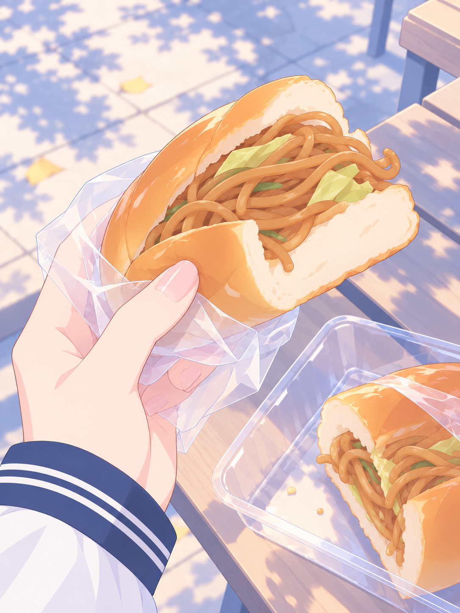

# 炒面面包：碧蓝档案画风尝试

> 最后一个，被我抢到了。

依据用户本轮要求，以原图为内容与构图参考，使用内置 imagegen 改画风并减少面包、面条的微小纹理。保留校服袖口和分成两半的面包。此版本是风格尝试，未替换固定画风参考。

后续选材方向按本轮反馈收敛到生活场景，游戏和屏幕截图暂不纳入。

[完整提示词](prompt.txt) · [生成记录](generation.json)
