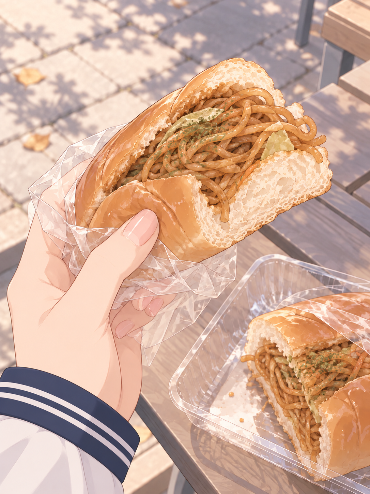
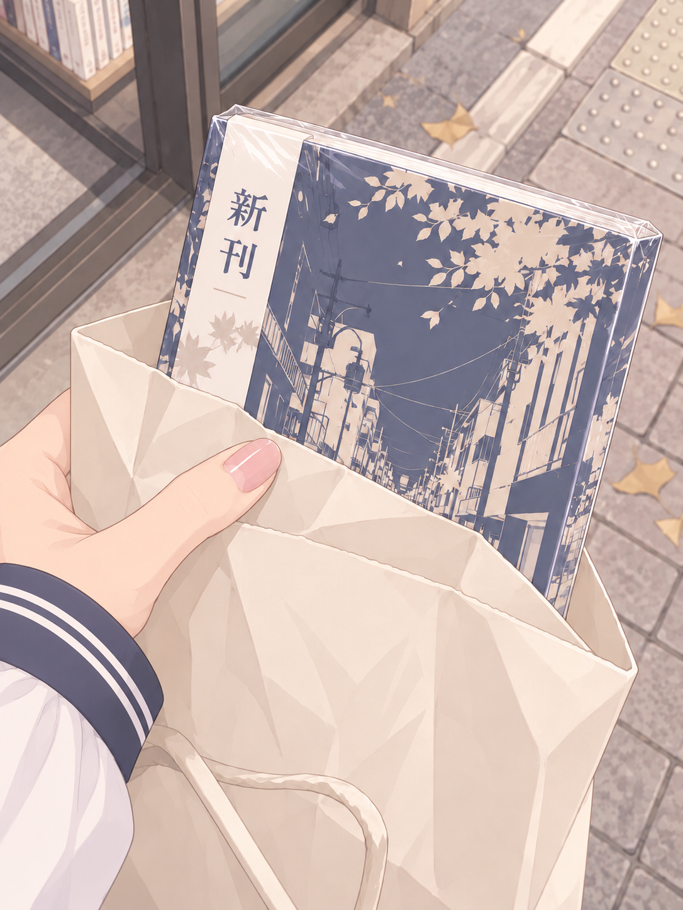
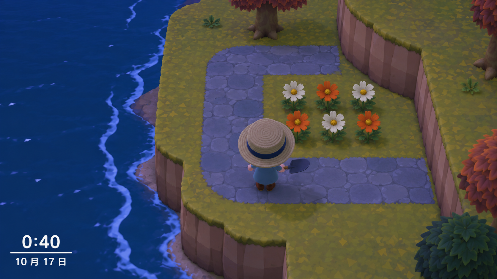

# 2026-10-16 日程：主动联系图文测试 v5

根据今天已生成的 12 段日程，选取 4 个候选时点，其中 3 个制作配图，1 个作纯文字对照。不是当日发送计划，不要求全部发送。时间是根据 story 和 places 推定的演练时点；未来段按假设场景处理。

## 选材与时间

| 测试时点 | 被什么触动 | 此刻能否联系 | 分享形式与第一句 |
|---|---|---|---|
| 10 月 16 日 12:40 | 抢到货架上的最后一个炒面面包，有一点得意 | 在露天休息区坐下、分好面包后有短暂空档；校规与使用手机条件未由日程提供，实际发送前须成立 | 食物随拍：最后一个，被我抢到了。 |
| 10 月 16 日 16:30 | 专程绕去神保町买到期待的新卷，想马上翻开 | 在漫画店买好之后、挤上回程电车之前；准确结账时刻未知 | 新书随拍：到手。已经等不及回家了。 |
| 10 月 16 日 23:50 左右 | 第二把决赛圈因侧面混战结束，有轻微不甘，但复盘气氛快乐 | 第二把结束、复盘笑闹时可能有空；游戏具体结束分钟未知 | 纯文字：侧面那队到底什么时候过来的…… |
| 10 月 17 日 00:40 | 整理西岸小路和花坛，想给人看这一个改动；“觉得顺眼”是依据投入与惬意作出的轻度表达推断 | 停下铺路、检查布局时具备截图条件；只在对方允许深夜联系时考虑 | 模拟游戏截图：这里拐一下，好像顺眼多了。 |

同处的 Niya 或 Sweyn 不是默认消息接收者；这里模拟向其他熟悉的聊天对象分享。小卖部买到后的具体分切、书店结账与夜间停手时间并非原文精确记录。

## 12:40 · 最后一个炒面面包

> 最后一个，被我抢到了。

图片指向她抢到的东西，分成两半保留了与 Niya 分享的事实。文字只露出一点得意，不把下课、跑去小卖部和分食的全过程讲完。图里的桌面、包装细节属于视觉补全。

[初始提示词](../../02_早期画风_衣柜参考随拍/2026-10-16_当日日程测试-v5/lunch-prompt.txt) · [校服袖口修订](../../02_早期画风_衣柜参考随拍/2026-10-16_当日日程测试-v5/lunch-edit-prompt.txt)

## 16:30 · 漫画新卷到手

> 到手。已经等不及回家了。

在刚买到、还没挤上电车的空档分享。原日程有“新卷”，却没有作品名称，因此本图只能使用虚构封面道具。这也暴露了素材不足：如果想让对方具体接着聊作品，后续日程或记忆应提供可核对的书名和卷数；不应该由图片生成临时决定一个真实书名，再把它当成既有经历。

[初始提示词](../../02_早期画风_衣柜参考随拍/2026-10-16_当日日程测试-v5/manga-prompt.txt) · [校服袖口修订](../../02_早期画风_衣柜参考随拍/2026-10-16_当日日程测试-v5/manga-edit-prompt.txt)

## 23:50 左右 · Apex 纯文字对照

> 侧面那队到底什么时候过来的……

原文只记录了决赛圈侧面混战、遗憾收场以及愉快复盘，没有明确名次、击杀、伤害、英雄或地图。此时直接吐槽足够，不额外制造结算面板。这个时点不能与另一条深夜候选机械叠加发送。

## 次日 00:40 · 动森西岸改路

> 这里拐一下，好像顺眼多了。

属于日程 24:00–26:00 段，在自然日上已经是 10 月 17 日。分享目标是新铺的小路与花坛之间的关系，因此采用游戏内视角；游戏画面保留自身的玩具式表现，不照搬随拍的衣物插画表现。

这是内置 imagegen 生成的模拟截图，不是真实岛屿存档。路径、花色、游戏人物外观与时间显示是演练补全。图中玩家背向镜头，无可见人脸。

[初始提示词](../../02_早期画风_衣柜参考随拍/2026-10-16_当日日程测试-v5/island-prompt.txt) · [游戏视角修订](../../02_早期画风_衣柜参考随拍/2026-10-16_当日日程测试-v5/island-edit-prompt.txt)

## 本轮取舍与检查

- 早晨赶路、上午数学题和晚市工作均不强行出主动消息。体育课下场虽有空档，但原文更像继续给 Niya 加油，没有一定要转向线上的理由。
- 午餐和新书图片的第一版出现了不匹配的袖口；核对日程 outfit 与现行衣柜后，修订为白色长袖、藏青袖口两道细白线。
- 小岛首版过于精致、偏场景模型，修订为较简洁的游戏视角。仍然只作为媒介选择演示，不声称还原真实游戏素材。
- 三张图均已查看，没有可见人脸。未改日程、衣柜或消息发送逻辑。

[当日日程原文快照](../../02_早期画风_衣柜参考随拍/2026-10-16_当日日程测试-v5/schedule-source.json) · [完整生成与检查记录](../../02_早期画风_衣柜参考随拍/2026-10-16_当日日程测试-v5/generation.json)
